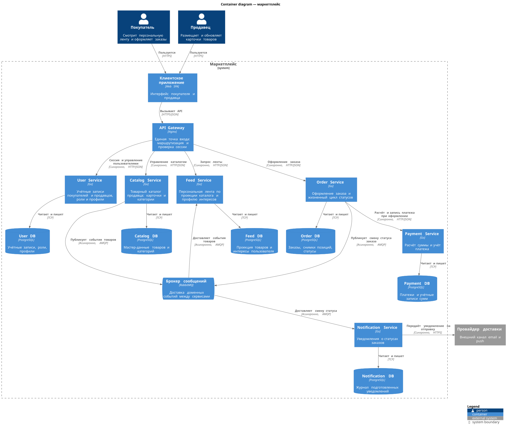

# Маркетплейс: архитектурное проектирование

Домашнее задание 1. Команды ниже запускаются из этой папки.

Цифровая платформа, на которой продавцы размещают товары, а покупатели получают персональную ленту и оформляют заказы. На этом этапе зафиксирована целевая архитектура и поднят каркас одного сервиса. Бизнес-функции не реализуются.

## Запуск

Нужны Docker и Docker Compose v2.

```bash
docker compose up --build -d
curl -i http://localhost:8080/health
```

Ожидаемый ответ:

```text
HTTP/1.1 200 OK
Content-Type: application/json

{"status":"ok"}
```

Остановка:

```bash
docker compose down
```

Поднимается `notification-service` из `services/notification-service`. Слушает порт `8080`, наружу отдан `GET /health`. Образ собирается многостадийно: бинарник на Go, runtime — Alpine. В контейнере есть `HEALTHCHECK` на тот же endpoint.

Сервис намеренно не подключается к базе и брокеру. Пока нет бизнес-операций, готовность процесса не должна зависеть от инфраструктуры, которой он ещё не пользуется. База и брокер на диаграмме — целевые контейнеры, а не часть текущего запуска.

## Что требует кейс

| Возможность | Зачем выделена |
| --- | --- |
| Персональная лента | Отдельный путь чтения, его можно обновлять с задержкой |
| Каталог продавца | Мастер-данные карточек, пишет продавец |
| Пользователи | Покупатели и продавцы, роли и профили |
| Заказы | Оформление и статусы |
| Платежи | Расчёт суммы и учёт, отдельно от статуса заказа |
| Уведомления | Реакция на статус, покупатель не ждёт их в запросе оформления |

## Персонализация ленты

Степень персонализации умеренная: лента отличается у разных покупателей, но ранжирование не считается моделью машинного обучения на каждом запросе.

- Сигналы: категории просмотренных и купленных товаров.
- Cold start, когда сигналов ещё нет: недавно опубликованные карточки без персонального веса.
- Данные для выдачи лежат в Feed Service: проекция активных карточек и профиль интересов пользователя.
- Catalog Service остаётся источником истины по карточке. Feed не ходит в каталог на каждый показ ленты.
- Допустимое отставание ленты — секунды, пока событие каталога дойдёт через брокер. Для витрины это приемлемо. В момент заказа Order Service сохраняет снимок названия и цены в позиции заказа, поэтому последующее редактирование карточки не переписывает уже созданный заказ.

Так персонализация не смешивается с записью каталога и не требует общей базы.

## C4: уровень Container

Диаграмма уровня Container: люди, граница системы, контейнеры (приложения, сервисы, хранилища, брокер), внешняя система доставки. Внутренние компоненты и классы на этом уровне не показаны. У каждого контейнера есть имя, технология и ответственность. У связей подписаны действие и способ вызова.

Исходник: [`docs/c4-container.puml`](docs/c4-container.puml) (C4-PlantUML). Картинка ниже собрана из этого файла.



API Gateway, брокер и базы — контейнеры, но не домены. Доменная модель — в следующем разделе. Клиентское приложение и шлюз входят в систему, потому что через них пользователи попадают в маркетплейс. Провайдер email/push снаружи: мы передаём ему уже сформированное уведомление и не храним у него состояние заказа.

## Домены и ответственность

1. **Identity.** Кто такой пользователь, покупатель он или продавец, данные профиля. Один человек может иметь обе роли, поэтому покупатель и продавец не разделены на два домена.
2. **Catalog.** Карточка товара и категория. Продавец создаёт и меняет их. Это единственный источник истины по составу витрины.
3. **Personalization.** Кому что показать в ленте. Хранит интересы и проекцию карточек для чтения. Не редактирует мастер-данные товара.
4. **Ordering.** Заказ, позиции и статус. Позиция хранит снимок цены и названия на момент оформления.
5. **Payments.** Сколько должен заплатить покупатель и как эта сумма учтена. Учётная запись платежа не переписывается при смене статуса заказа.
6. **Notifications.** Сообщить покупателю, что статус заказа изменился. Не решает, какой статус выставить.

## Как домены разложены по сервисам

Выбранное разбиение — один сервис на домен.

| Домен | Сервис | Почему этот сервис, а не соседний |
| --- | --- | --- |
| Identity | User Service | Сессия и роли нужны шлюзу до вызова остальных сервисов. Остальные получают идентификатор пользователя и не читают чужие учётные записи |
| Catalog | Catalog Service | Запись продавца отделена от чтения ленты: у них разная нагрузка и разная свежесть данных |
| Personalization | Feed Service | Лента читает собственную проекцию. Её можно пересобрать из событий каталога, не останавливая запись карточек |
| Ordering | Order Service | Статусная модель заказа — отдельный жизненный цикл. Он инициирует расчёт платежа, но не ведёт реестр платежей |
| Payments | Payment Service | Инвариант учёта другой: сумма фиксируется и не следует за редактированием заказа |
| Notifications | Notification Service | Доставка — побочный эффект статуса. Она не должна участвовать в запросе, которым покупатель оформляет заказ |

Шлюз доменных данных не хранит. Он синхронно проверяет сессию в User Service и маршрутизирует вызов.

## Границы данных и взаимодействие

Общей базы нет. Ссылка на пользователя или товар в другом сервисе — это идентификатор, не внешний ключ в чужой схеме. Каждый сервис пишет только в свою базу.

| Сервис | Чем владеет | За что отвечает |
| --- | --- | --- |
| User Service | Учётные записи, роли, профили в User DB | Создание пользователей и проверка сессии |
| Catalog Service | Товары и категории в Catalog DB | Приём изменений от продавца и публикация событий карточки |
| Feed Service | Проекция карточек и профиль интересов в Feed DB | Сборка персональной ленты. Мастер-данные товара не изменяет |
| Order Service | Заказы, снимки позиций, статусы в Order DB | Приём оформления и смена статуса. Реестр платежей не хранит |
| Payment Service | Платежи и учётные суммы в Payment DB | Расчёт и запись платежа по запросу заказа |
| Notification Service | Журнал уведомлений в Notification DB | Реакция на смену статуса и передача сообщения провайдеру доставки |

Синхронный вызов используется там, где ответ нужен, чтобы закончить текущий запрос пользователя. Асинхронный — там, где вызывающий завершает свою работу, не дожидаясь потребителя.

| Кто | Кому | Как | Зачем |
| --- | --- | --- | --- |
| Клиентское приложение | API Gateway | Синхронно, HTTPS | Все сценарии пользователя |
| API Gateway | User Service | Синхронно, HTTP | Проверка сессии и операции с пользователями |
| API Gateway | Catalog Service | Синхронно, HTTP | Продавец сразу видит результат сохранения карточки |
| API Gateway | Feed Service | Синхронно, HTTP | Покупатель сразу получает ленту |
| API Gateway | Order Service | Синхронно, HTTP | Покупатель сразу получает результат оформления |
| Order Service | Payment Service | Синхронно, HTTP | Заказ не считается оформленным, пока платёж не рассчитан и не записан |
| Catalog Service | Брокер → Feed Service | Асинхронно, AMQP | Обновление проекции ленты. Запись карточки не ждёт пересчёт ленты |
| Order Service | Брокер → Notification Service | Асинхронно, AMQP | Уведомление о новом статусе. Оформление не ждёт доставку письма или push |
| Notification Service | Провайдер доставки | Синхронно, HTTPS | Передача уже подготовленного сообщения во внешний канал |

Следствия, которые принимаются вместе с этими границами:

- Если Payment Service недоступен, оформление не завершается. Заказ не создаётся «как будто оплачен».
- Лента может на короткое время показывать карточку до того, как продавец уже снял её с публикации, или не показывать только что опубликованную. Источник истины при открытии карточки и при заказе — Catalog, не проекция ленты.
- Повторная доставка события не создаёт второй платёж и второе уведомление: потребители ориентируются на идентификатор события. Это правило границы, реализация потребителей в этот этап не входит.

## Два варианта декомпозиции

### Вариант 1. Модульный монолит

Один разворачиваемый процесс и одна база. Домены существуют как модули внутри процесса: identity, catalog, feed, ordering, payments, notifications. Модуль не читает таблицы другого модуля напрямую, но физически база одна, транзакция оформления заказа и записи платежа может быть общей.

### Вариант 2. Сервис на домен

Шесть сервисов из диаграммы, у каждого своя база. Согласование заказа и платежа — один синхронный вызов. Согласование каталога с лентой и заказа с уведомлениями — события через брокер. Общих таблиц нет.

Варианты различаются единицей поставки, моделью согласованности и тем, есть ли общая база. Это не два названия одной схемы.

## Trade-off

### Вариант 1

Плюсы:

- Оформление заказа и учёт платежа фиксируются одной локальной транзакцией. Недоступность «соседнего сервиса» невозможна, потому что соседа нет.
- Один процесс и одна база: проще локальный запуск и меньше отказов из-за сети.
- Лента читает те же карточки, что только что записал продавец, без задержки на брокер.

Минусы:

- Чтение ленты и запись каталога делят один пул соединений и один релиз. Нагрузку на выдачу нельзя нарастить отдельно от формы редактирования карточки.
- Сбой или медленная отправка уведомления находится в том же процессе, который принимает заказ.
- Схема платёжного учёта меняется вместе со схемой заказов и каталога. Ошибка миграции в одном модуле останавливает всю платформу.

### Вариант 2

Плюсы:

- Запись каталога и чтение ленты масштабируются и выпускаются отдельно. Проекция ленты пересобирается из событий, не блокируя продавца.
- Уведомление не стоит на пути оформления: Order Service публикует статус и отвечает покупателю.
- Платёжная запись живёт в своей базе. Смена статуса заказа её не переписывает, схема учёта меняется своим релизом.

Минусы:

- Оформление зависит от доступности Payment Service: синхронный вызов делает checkout недоступным, когда недоступен учёт платежей.
- Лента отстаёт от каталога на время доставки события. Нужна явная договорённость, что витрина может быть не мгновенно точной.
- Шесть сервисов, шесть баз и брокер дороже в эксплуатации, чем один процесс. Появляется класс отказов «событие дошло дважды» и «событие дошло не сразу».

## Почему выбран вариант 2

Выбран вариант 2.

Кейс перечисляет шесть возможностей с разной свежестью и разным инвариантом данных. Лента может отставать. Платёжная запись — нет. Уведомление не нужно, чтобы ответить на оформление заказа. Общая база монолита как раз стирает эти различия: все модули либо свежие в одной транзакции, либо падают вместе.

Синхронный вызов Order → Payment оставлен точечно, потому что покупатель ждёт результат оформления, а заказ без записанного платежа для этого кейса не является успешным. Это дороже, чем локальная транзакция монолита, и это принято сознательно: граница учёта важнее простоты одного коммита. Каталог с лентой и заказ с уведомлениями через брокер, потому что там задержка не меняет ответ пользователю в текущем запросе.

Вариант 1 был бы уместнее, если бы целью был один контур с общей транзакцией на checkout и одинаковой свежестью ленты и каталога. В этом кейсе свежесть ленты как раз можно ослабить, а учёт платежей и каталог ослаблять нельзя. Поэтому монолит не выбран.

На текущем шаге из варианта 2 в коде живёт только каркас Notification Service. Остальные контейнеры описаны диаграммой и этим документом и не поднимаются.

## Состав репозитория

```text
README.md
docker-compose.yml
docs/c4-container.puml
docs/c4-container.svg
services/notification-service/
  main.go
  Dockerfile
```
